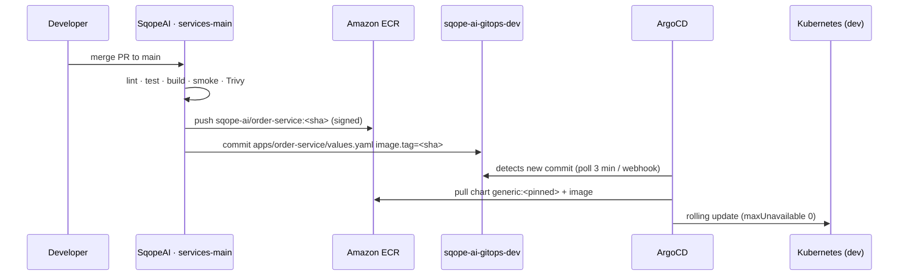

# sqope-ai-gitops-dev

The **desired state of the Sqope AI `dev` environment**. ArgoCD continuously makes the cluster
match this repo.

It holds **values only**. There is no chart and no application code:
- the shared Helm chart (`generic`) is built in [SqopeAI](https://github.com/gologolo24/SqopeAI)
  and pulled from **ECR as a versioned OCI artifact**
- images are built in SqopeAI and pushed to ECR, **tagged with the git commit SHA**

## Why values only?

- **Small, readable diffs.** Every commit here is a deployment, a config change or a rollback.
  `git log` *is* the deployment history of dev.
- **Each environment pins its own chart version.** A chart change is released once, then rolled
  out per environment by bumping `targetRevision`. It never reaches every environment at once.
- **Separate access.** CI can write image tags here without having any access to the cluster, and
  developers can change code without being able to change what's deployed.

## Layout

```
apps/
  user-service/values.yaml          per-service config for dev: image, replicas/HPA, env, resources
  order-service/values.yaml
  notification-service/values.yaml
argocd/
  project.yaml                      AppProject sqope-dev: allowed sources, namespaces, resource kinds
  applicationset.yaml               one Application per apps/* folder (chart from ECR + values from here)
bootstrap/
  root-app.yaml                     app-of-apps: lets ArgoCD manage argocd/ itself (applied once)
```

## How a deploy happens



## Common tasks

| Task | How |
|---|---|
| **Deploy a new version** | Nothing to do: merging to SqopeAI `main` commits the new `image.tag` here. |
| **Roll back** | `git revert <deploy commit>` and push. ArgoCD syncs the previous SHA, which still exists because ECR tags are immutable. |
| **Change config** (replicas, env, resources) | PR editing `apps/<service>/values.yaml`. |
| **Add a service** | Add `apps/<new-service>/values.yaml`. The ApplicationSet creates the Application and namespace. |
| **Upgrade the chart** | After `helm-chart-cicd` releases `generic:X.Y.Z`, open a PR bumping `targetRevision` in `argocd/applicationset.yaml`. |

## Sync behaviour, and why

| Setting | Why |
|---|---|
| `automated.prune: true` | Resources removed from git are removed from the cluster, so there's no drift. |
| `automated.selfHeal: true` | Manual `kubectl` edits are reverted. Git is the only way to change dev. |
| `preserveResourcesOnDeletion: true` (ApplicationSet) | Deleting a folder or the ApplicationSet by mistake doesn't cascade into deleting running workloads. |
| One namespace per service | Isolation, plus room for per-service quotas, RBAC and NetworkPolicies. |
| `retry` with backoff | Rides out transient errors, such as the registry or API server being briefly unavailable. |
| AppProject whitelists | Apps can only create the resource kinds the chart produces, only in `*-service` namespaces. |

## Bootstrap (done by the infra repo, next step)

1. Install ArgoCD and External Secrets Operator on the cluster.
2. Give ArgoCD read access to the ECR OCI chart repository. ECR tokens expire after 12 h, so an
   `ExternalSecret` using ESO's `ECRAuthorizationToken` generator keeps the ArgoCD repository
   secret (`type: helm`, `enableOCI: "true"`) fresh. Nodes pull images through their IAM role.
3. Replace the placeholder account `123456789012` in `apps/*/values.yaml` and `argocd/*.yaml`.
4. Run `kubectl apply -n argocd -f bootstrap/root-app.yaml`. From then on, everything is managed
   through git.

This repo is public so reviewers can read it, which means ArgoCD needs no credentials for it. In a
real company it would be private, with a **read-only** deploy key for ArgoCD. CI writes with a
separate, write-enabled key that's restricted to SqopeAI's `dev` GitHub Environment.

## Other environments

Staging and prod get their own `sqope-ai-gitops-<env>` repos, with stricter rules than dev:
- **Promoted via PR with required approval**, never committed to directly by CI
- The **same image SHA and chart version** that ran in dev, never rebuilt
- Separate write access per environment
